# C. For Site Administrators

This chapter covers the configuration and operation of a ZMS installation. It addresses user management, multilingual configuration, content-model design, search indexing, AI/LLM connectors, theming, and production deployment topics such as caching and reverse-proxy integration.

---

## 1. The Configuration Menu

The ZMS configuration menu (accessible via the gear icon in the top bar, visible to users with admin privileges) provides ten main sections:

| # | Section | Purpose |
|---|---|---|
| 1 | **User** | Manage user accounts and access rights |
| 2 | **System** | System variables, multisite hierarchies, functional components |
| 3 | **Languages** | Languages and their editorial dependencies |
| 4 | **Meta-Attributes** | General content attributes (Dublin Core-style metadata) |
| 5 | **Content-Objects** | Model content classes and their attribute schemas |
| 6 | **Paragraph-Formats** | Text block formatting presets |
| 7 | **Character-Formats** | Text inline formatting (bold, italic, custom spans) |
| 8 | **Actions** | Additional / self-programmed helper functions |
| 9 | **Search** | Configure content indexing (ZCatalog, Solr) |
| 10 | **Design** | Design themes and JS/CSS customization |

---

## 2. User Management

The **User** section of the configuration menu lets the administrator:

- Create, edit, and delete local ZMS user accounts.
- Assign users to roles: *Reader*, *Author*, *Editor*, *Manager*.
- Delegate authentication to Zope's built-in user folder or an external LDAP/Active Directory source.

Roles control which workflow transitions a user can trigger and which parts of the configuration menu are visible.

---

## 3. Languages {#languages}

ZMS uses a **symmetric hierarchical** multilingual model:

- **Symmetric** — all language variants of a content object are stored side-by-side in a single object (not in separate sub-sites).
- **Hierarchical** — languages are organised in a dependency tree. A *primary language* is the source; *secondary* or *dependent* languages inherit content from their parent and can override it with local variants.

### Configuring languages

Open **Administration → Languages**. The upper section defines available languages and their dependency structure. The lower section provides the **Language Dictionary** — a table of language-neutral keys and their translations.

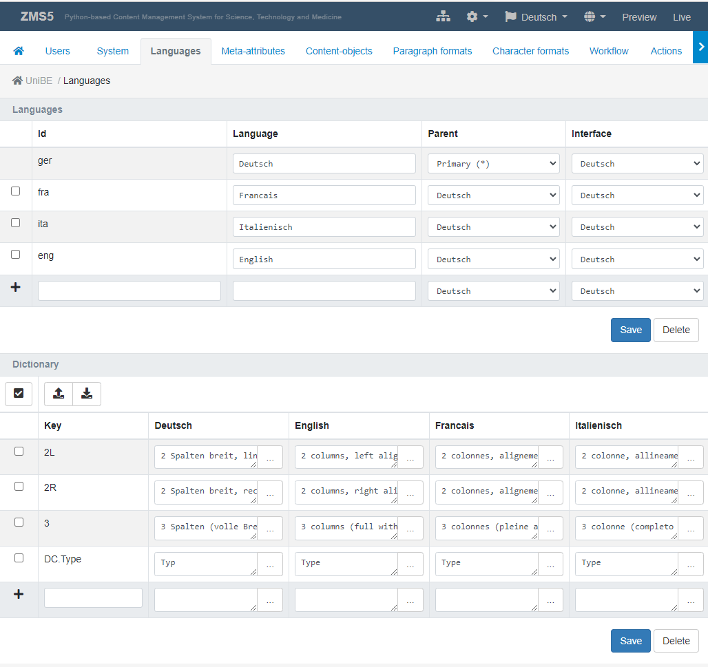\
*Language configuration: available languages and dependencies (upper); language dictionary (lower)*

### Language dictionary

Display labels for content classes and attributes in the ZMI can be internationalised. Naming conventions:

- `TYPE_<NAME>` — translation key for a content class display name (e.g. `TYPE_BOX`).
- `ATTR_<NAME>` — translation key for an attribute display name (e.g. `ATTR_TITLE`).

If a matching entry exists in the language dictionary, it overrides the literal label stored in the content model.

---

## 4. Meta-Attributes

Meta-attributes (or *metas*) are site-wide descriptive attributes inspired by the [Dublin Core Metadata Initiative](https://en.wikipedia.org/wiki/Dublin_Core). Every content object automatically inherits all configured meta-attributes.

Common defaults include:

- `attr_dc_title` — document title
- `attr_dc_description` — summary / abstract
- `attr_dc_creator` — author
- `attr_dc_date` — publication date
- `attr_dc_subject` — keyword tags

Administrators can add further meta-attributes and assign a data type to each. Because any meta-attribute becomes a new data type usable across all content classes, a coherent metadata concept reduces template complexity and supports consistent full-text indexing.

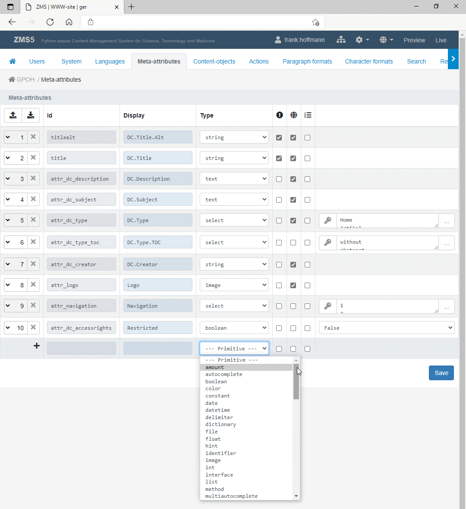\
*Meta-attribute administration*

---

## 5. Content Objects (Content Model)

ZMS uses a **content model** (also called *schema*) that defines an arbitrary number of content class definitions.

### Pages and blocks

- **Page-like objects** (`ZMSFolder`, `ZMSDocument`) aggregate block elements and may nest other page objects.
- **Block elements** (`ZMSTextarea`, `ZMSFile`, `ZMSGraphic`, …) hold actual content and are arranged in sequences inside pages.

### Defining a content class

1. Open **Administration → Content-Objects**.
2. Add a new class and give it an ID and display label.
3. Add attributes by selecting from the available data types (text, integer, image, resource, TAL expression, Python script, …).
4. Mark attributes as **multilingual** (globe icon) if they need language-specific values.
5. After the attribute list is complete, edit the `standard_html` TAL template to render the content. Use the **Refresh** button to generate a prototype TAL snippet from the current attribute schema.

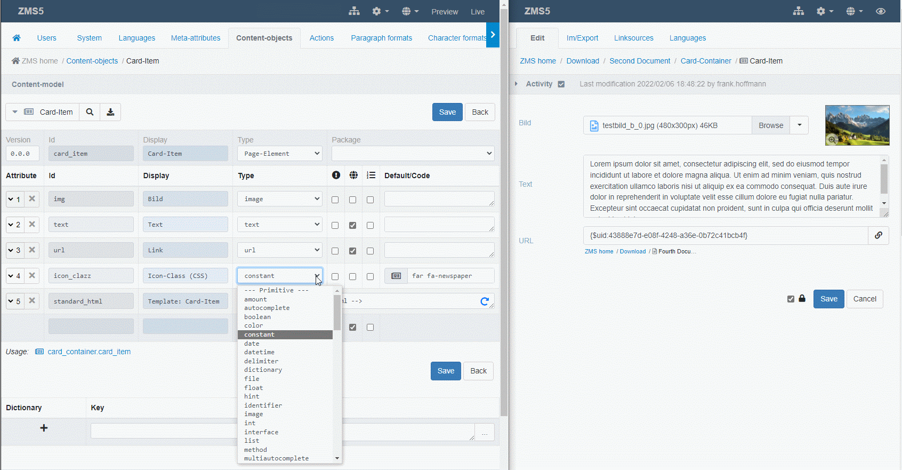\
*Example: a `carditem` object model with image, text, and URL attributes*

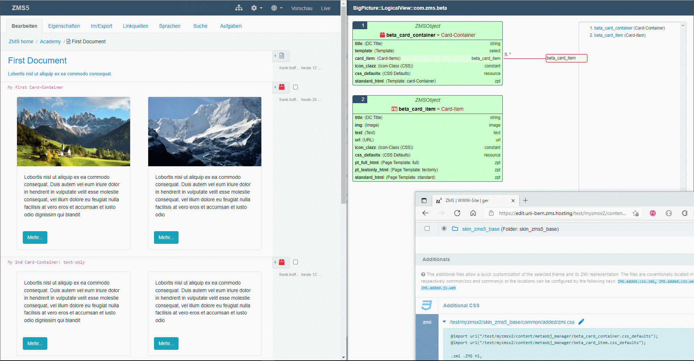\
*Nested models: a `card_container` aggregating `carditem` instances*

### Multilingual attribute labels

Attribute display names in the content model can be made multilingual by following the `TYPE_`/`ATTR_` naming convention described in [§ 3 Languages](#languages).

---

## 6. Paragraph and Character Formats

### Paragraph formats

Paragraph formats define the block-level HTML element wrapping a `ZMSTextarea` content. They are used by both the plain-text editor (applied to the whole block) and the rich-text editor (applied to individual paragraphs).

Each format is defined by:

- ID, display name
- Wrapping HTML element and attributes
- Newline tag
- Whether it is available in plain and/or rich-text editors
- Whether it is the default format
- Whether it forces use of the rich-text editor

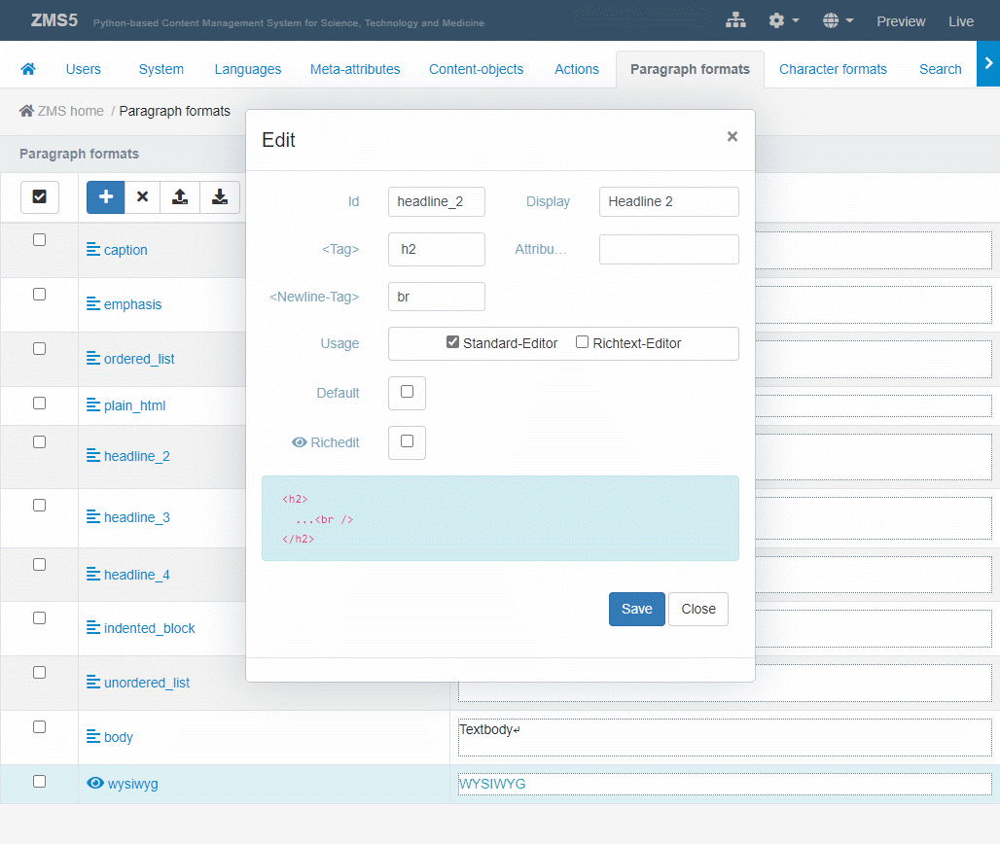\
*Paragraph format configuration form*

### Standard (plain-text) editor

The standard text editor provides a plain-text `<textarea>` input. It is possible to add inline HTML tags manually, but invalid HTML can creep in. To help catch this, enable the realtime HTML validity check via the system parameter:

```
ZMS.ZMSTextarea.show_htmlcheck = True
```

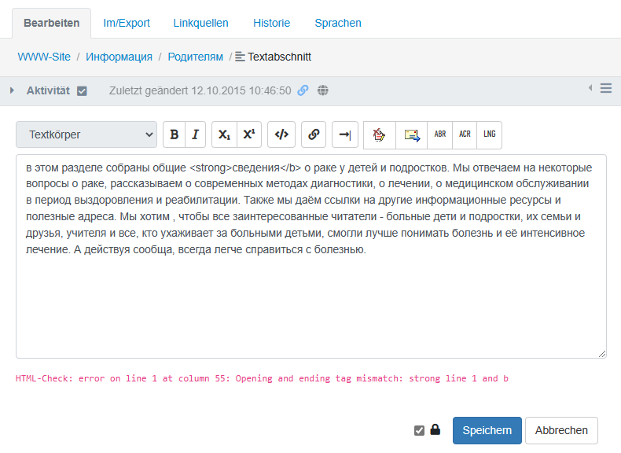\
*HTML validity check indicator controlled by `ZMS.ZMSTextarea.show_htmlcheck`*

### Rich-text editors (RTE)

ZMS ships with four RTEs selectable via the system parameter `ZMS.richtext.plugin`:

1. **CKEditor** (HTML)
2. **TinyMCE** (HTML)
3. **SimpleMDE** (Markdown)
4. **EasyMDE** (Markdown)

To add a custom RTE, create a folder at `Products/zms/plugins/rte/MyRTE/` containing a TAL template `manage_form.zpt` that renders the editor's HTML snippet. Place JavaScript and CSS resources in `Products/zms/plugins/www/MyRTE/` and reference them with ZMS resource links.

### Character formats

Inline (character) formats add custom `<span>` wrappers or other inline HTML elements inside text blocks. Each format is defined by ID, display name, button icon, wrapping HTML element/attributes, and optional JavaScript event handling.

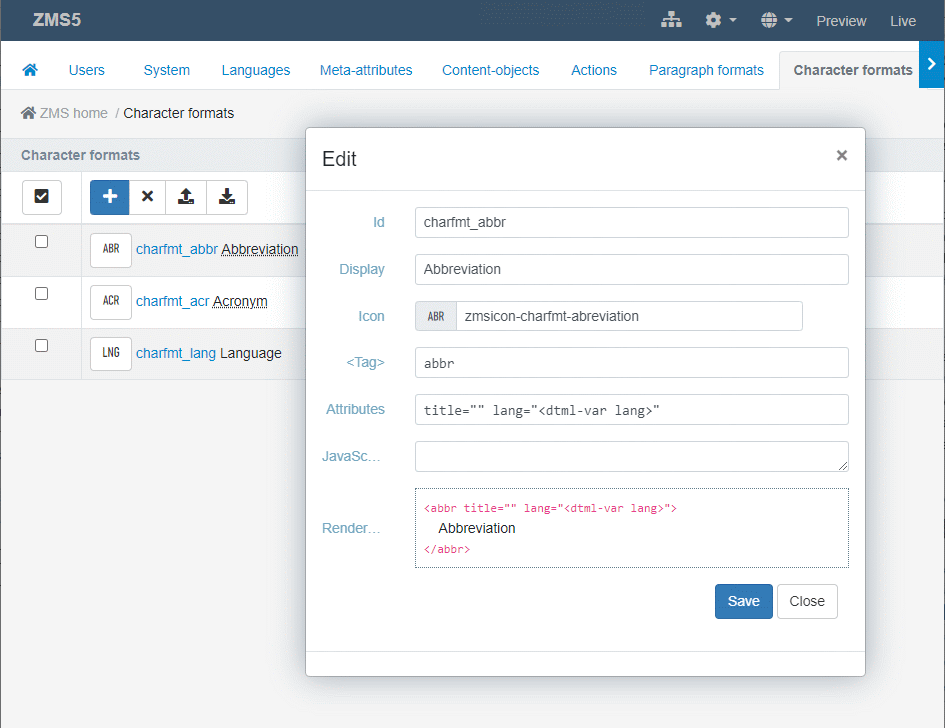\
*Inline character-format configuration*

---

## 7. Search

### 7.1 ZCatalog (built-in)

ZMS integrates with Zope's built-in **ZCatalog** for lightweight full-text search.

- Open **Administration → Search → Adapter** to choose which content classes and attributes to index.
- Index objects are named `catalog_<lang>` (e.g. `catalog_eng`) and are held inside the ZMS `content` object.
- In a **multisite** hierarchy only the root ZMS catalog collects all index data. Local content classes not inherited from the root must be registered individually in each client's Search configuration. **Important:** attribute schemas defined in sub-sites are ignored for global indexing — all indexed attributes must be declared in the root ZMS object.

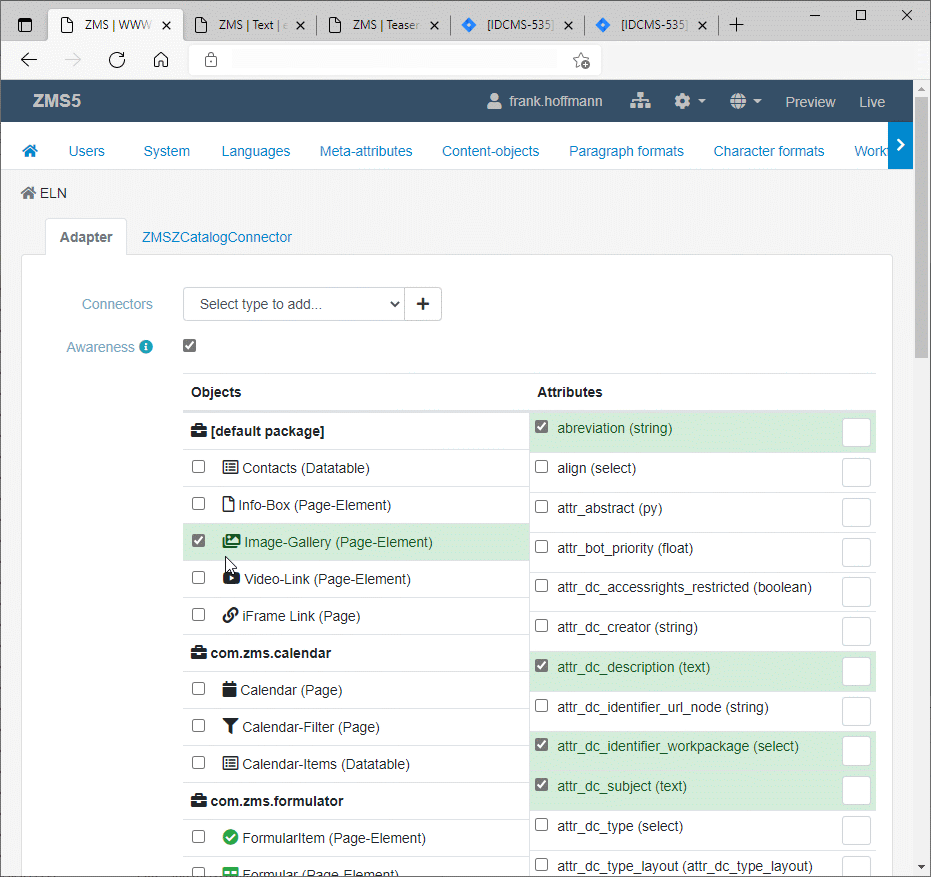\
*Selecting content classes and attributes for indexing*

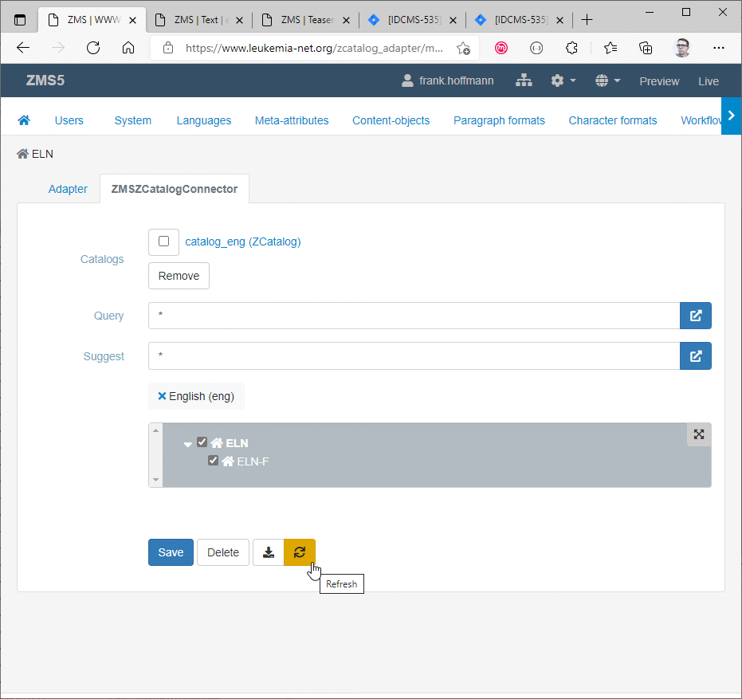\
*ZCatalog connector administration*

### Integrating the search form in your theme

Your theme template must:

1. Provide a `ZMSDocument` page node containing a `ZMSTextarea` with the TAL-based search form (input field + results placeholder).
2. Include the ZMS search JavaScript module:

```html
<script type="text/javascript" src="/++resource++zms_/zmi.core.js"></script>
<script type="text/javascript" src="/++resource++zms_/ZMS/zmi_body_content_search.js"></script>
```

Full search form TAL template (input section + asynchronous results placeholder):

```html
<form class="search" method="get" xmlns:tal="http://xml.zope.org/namespaces/tal">

  <tal:block tal:condition="python:request.get('searchform',True)">
    <input tal:condition="python:request.get('searchform')" type="hidden" name="searchform"
           tal:attributes="value python:request.get('searchform')" />
    <input tal:condition="python:request.get('lang')" type="hidden" name="lang"
           tal:attributes="value python:request.get('lang')" />
    <input tal:condition="python:request.get('preview')" type="hidden" name="preview"
           tal:attributes="value python:request.get('preview')" />
    <legend tal:content="python:here.getZMILangStr('SEARCH_HEADER')">Search header</legend>
    <div class="form-group">
      <div class="col-md-12">
        <div class="input-group">
          <tal:block tal:content="structure python:here.getTextInput(fmName='searchform',elName='search',value=request.get('search',''))">the value</tal:block>
          <span class="input-group-btn">
            <button type="submit" class="btn btn-primary">
              <i class="fa fa-search icon-search"></i>
            </button>
          </span>
        </div>
      </div>
    </div><!-- .form-group -->
    <div class="form-group row"
         tal:condition="python:here.getPortalMaster() is not None or len(here.getPortalClients())>0">
      <div class="control-label col-md-12" tal:define="home_id python:here.getHome().id">
        <input type="hidden" name="home_id"
               tal:attributes="value python:request.get('home_id',home_id); data-value home_id" />
        <input type="checkbox" class="form-check-input"
               onchange="var $i=$('input[name=home_id]');$i.val(this.checked?$i.attr('data-value'):'');"
               tal:attributes="checked python:['','checked'][request.get('home_id',home_id)==home_id]" />
        <label class="form-check-label control-label">
          <strong tal:content="home_id">the home-id</strong> (local)
        </label>
      </div>
    </div><!-- .form-group -->
  </tal:block>

  <div id="search_results" class="form-group" style="display:none">
    <div class="col-md-12">
      <h4 tal:content="python:here.getZMILangStr('SEARCH_HEADERRESULT')">Result</h4>
      <div class="header row">
        <div class="col-md-12">
          <span class="small-head">
            <span class="glyphicon glyphicon-refresh fas fa-spinner fa-spin" alt="Loading..."></span>
            <tal:block tal:content="python:here.getZMILangStr('MSG_LOADING')">loading</tal:block>
          </span>
        </div>
      </div><!-- .header.row -->
      <div class="line row"></div>
      <div class="pull-right"><ul class="pagination"></ul></div>
    </div>
  </div>

</form>
```

The form's request is answered by an XML stream transformed into HTML by JavaScript.

**Permalink for the search page:** Instead of hardcoding the node ID, define a permalink property `ZMS.permalink.search` on the ZMS root node. Reference it in master templates like this:

```html
<html lang="en"
  tal:define="zmscontext options/zmscontext;
    search_node python: zmscontext.getLinkObj(
      zmscontext.getConfProperty('ZMS.permalink.search', default='{$@content}'), request);">
```

Generate the search link:

```html
<a href="#"
  tal:attributes="href python:search_node.getHref2IndexHtml(request)">
  <i class="fas fa-search"></i>&nbsp;
  <span tal:replace="python:zmscontext.getLangStr('SEARCH')">Search</span>
</a>
```

**Multisite search filtering:** To restrict search results to the current ZMS client, pass `home_id` in the form:

```html
<form class="search" method="get">
  <input type="hidden" name="home_id" value="myzms">
  ...
</form>
```

Reference the search page via a permalink system property `ZMS.permalink.search` to avoid hardcoded IDs across templates.

### 7.2 Apache Solr connector

For large sites or advanced search features (facets, highlighting, PDF indexing) ZMS provides a Solr connector.

**Overview:**

1. Import the two default ZMS actions from **Administration → Actions**:
   - `manage_zcatalog_create_sitemap` — generates a Solr-schema-conformant XML file.
   - `manage_zcatalog_update_documents` — transfers the XML to the Solr server.

2. Under **Administration → Search**, add the `ZMSZCatalogSolrConnector` and configure:
   - **URL** — HTTP API URL of the Solr server.
   - **Core** — name of the Solr core.

3. Create the Solr core on the server:
   ```shell
   solr@server:~$ solr create_core -c mysite
   ```

4. Run *Create XML Sitemap* then *Update SOLR Document Index* to perform the initial index load.

**PDF indexing:** Install `pdfminer.six` to enable automatic PDF text extraction into the sitemap XML:

```shell
zope@server:~$ ~/venv/bin/pip install pdfminer.six
```

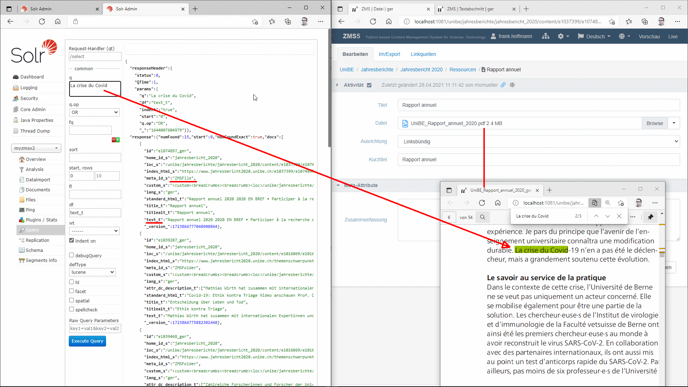\
*ZMS transfers PDF content by extracting plain text and adding it to the sitemap XML.*

### Running Solr as a Docker container

#### Dockerfile

```docker
FROM solr:8

# Apply security updates
USER root
RUN apt-get update && apt-get -y upgrade && apt-get clean
USER solr
```

#### systemd service for Solr (Docker / Podman)

Place the following file at `/etc/systemd/system/solr.service` on the host:

```ini
[Unit]
Description=Apache SOLR search engine

[Service]
Type=simple
User=solr
Restart=always
Environment="GODEBUG=netdns=go"
# Remove old container before building a new image
ExecStartPre=-/usr/bin/podman container stop solr
ExecStartPre=-/usr/bin/podman container rm solr
# Apply security updates on each restart
ExecStartPre=/usr/bin/podman build --pull --no-cache -f /home/solr/Dockerfile -t solr:8-security-updated
ExecStart=/usr/bin/podman run --rm -it -v "/home/solr/data:/var/solr" -p 8983:8983 --name solr solr:8-security-updated
ExecStop=/usr/bin/podman stop solr

[Install]
WantedBy=multi-user.target
```

Enable and start:

```shell
root@server:~$ systemctl daemon-reload
root@server:~$ systemctl enable solr
root@server:~$ systemctl start solr
```

#### Creating a Solr core in a Docker container

```shell
localhost:~$ ssh root@solr.server.hosting
root@server:~$ su - solr
solr@server:~$ podman exec -it solr bash
solr@container:/opt/solr-8.11.2$ solr create_core -c playground
```

---

## 8. Repository Manager and Git Bridge

### 8.1 Repository Manager

The **ZMS Repository Manager** synchronises custom ZMS code (metadata, content models, actions, workflow definitions) between the ZODB and a filesystem folder. Activate it under **Administration → System**.

Key properties:

| Property | Description |
|---|---|
| **System Path** | Filesystem location for code replication. Default: `$INSTANCE_HOME/var/$zms_id`. The variable `$INSTANCE_HOME` resolves to the Zope instance folder. The system property `ZMS.conf.path` stores the active path; `ZMS.conf.paths` can hold a comma-separated list of candidates for selection. |
| **Working Mode** | *Export* (ZODB → filesystem) or *Import* (filesystem → ZODB) |
| **Ignore Orphans** | Skip files not managed by version control |
| **Auto-Sync** | Export automatically on model changes (requires `ZMS.debug = True`). In *Import* mode, Auto-Sync still requires manual confirmation. |

Diff colour conventions: green = new, red = deleted, yellow = modified. The colour perspective inverts between Export and Import modes: in Export mode, new ZODB code is green; in Import mode, newer filesystem code is green.

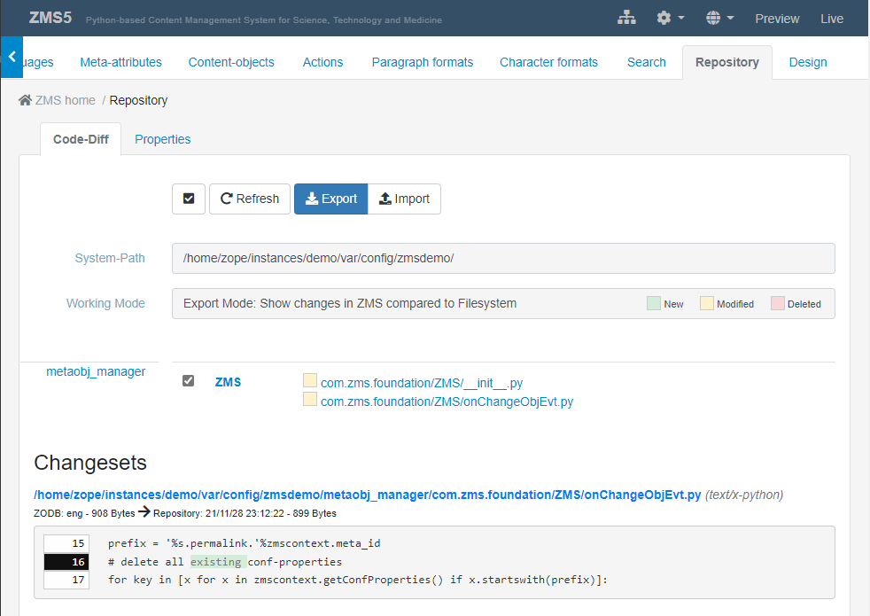\
*Repository Manager: diff view with Export/Import controls*

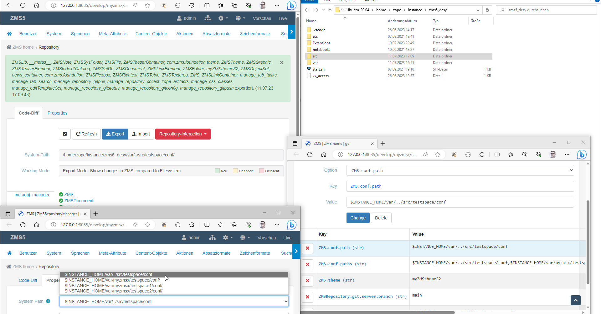\
*Repository Manager properties: System Path supports `$INSTANCE_HOME` path components*

### 8.2 Git Bridge

The ZMS Git Bridge allows TTW (through-the-web) development to coexist with Git-based collaboration.

1. Configure the filesystem repository folder as a Git clone.
2. Import the three Git actions (`gitconfig`, `gitpull`, `gitpush`) from **Administration → Actions**.

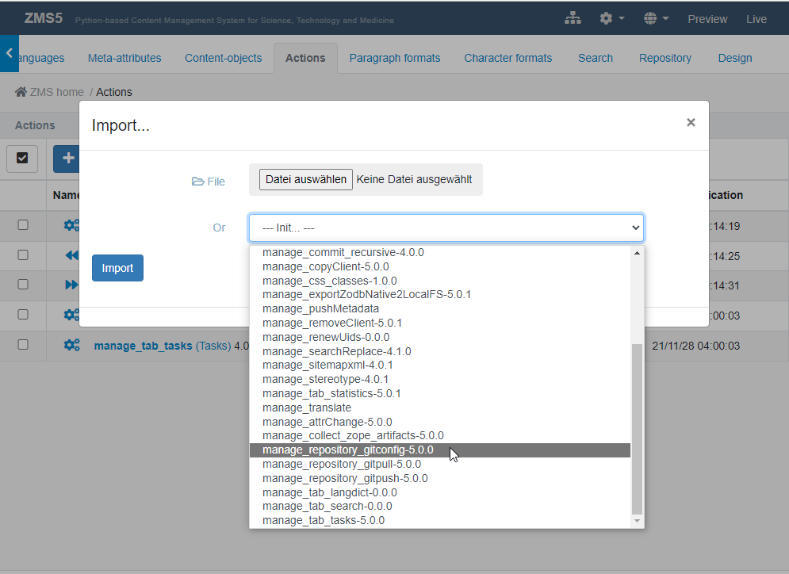

After importing, the Repository Manager gains a **Repository Interactions** pop-up menu:

- **Git Configuration** — enter the Git remote URL and optionally clone.
- **Git Pull** — pull the latest revision (or a specific commit). Use *Hard Reset* to force-overwrite local changes.
- **Git Push** — enter a commit message and push.

A dedicated SSH key for the Zope user is recommended:

```ini
# ~/.ssh/config
Host github.com
    HostName github.com
    IdentityFile ~/.ssh/zope_deploy_key
    User git
```

The `.git/config` file in the repository folder should be pre-configured before using it with ZMS:

```ini
[user]
    name = mygituser
    email = mygituser@mydomain.tld
[core]
    repositoryformatversion = 0
    filemode = true
    bare = false
    logallrefupdates = true
[remote "origin"]
    url = git@github.com:mydomain/myproject.git
    fetch = +refs/heads/*:refs/remotes/origin/*
[branch "master"]
    remote = origin
    merge = refs/heads/master
```

> The Git URL saved via *Git Configuration* is only needed if cloning via the ZMS GUI. If the `.git/config` file is already in place, the URL does not need to be entered again.

The Git Bridge uses a minimal command set:

- **Git Pull** — pulls (with checkout) the latest `HEAD` or a specific revision ID; *Hard Reset* forces an overwrite of local changes.
- **Git Push** — pushes the current state to the main branch with a commit message.

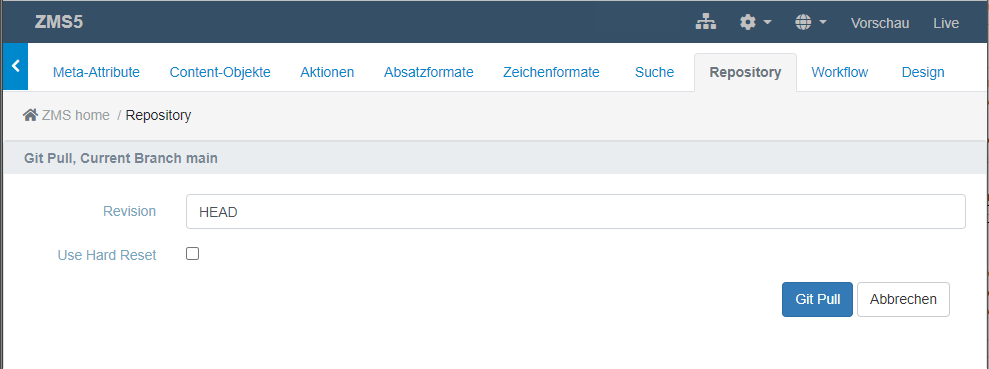\
*Git pull menu: optionally enter a revision ID and enable Hard Reset to force-overwrite local changes.*

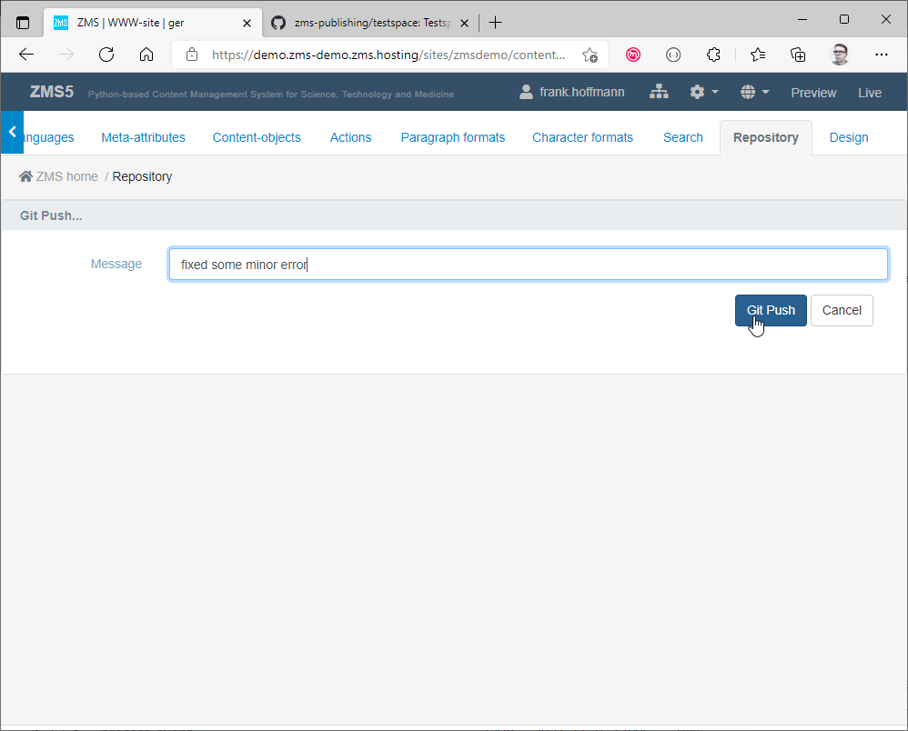\
*Git push menu: enter a commit message before pushing.*

---

## 9. Theming and Design

ZMS themes live in `docs/theming/` and the bundled theme templates are found under `Products/zms/zpt/`. The **Design** configuration menu section allows uploading and activating custom CSS/JS resources.

Key theming documentation:

| Document | Topic |
|---|---|
| [theming/structure.md](theming/structure.md) | Theme folder layout |
| [theming/templates.md](theming/templates.md) | TAL/METAL template conventions |
| [theming/css.md](theming/css.md) | CSS architecture |
| [theming/assets.md](theming/assets.md) | Static asset management |
| [theming/automation.md](theming/automation.md) | Build automation |
| [theming/ai.md](theming/ai.md) | AI-assisted theming |
| [theming/figma.md](theming/figma.md) | Figma-to-ZMS workflow |

---

## 10. Workflow and Versioning {#workflow}

### Overview

The two primary tools for content quality assurance in ZMS are *workflow* and *versioning*:

- **Workflow** ensures that the right person edits or reviews content at the right time.
- **Versioning** ensures that the history of editing steps remains transparent and traceable.

A workflow requires at least two versions of a document:

1. *Working version* — being edited (not yet publicly visible).
2. *Published version* (live version) — the current public state.

When a document enters the workflow, a copy of the currently published version is created as the working version. When the document is committed, the working version overwrites the live version permanently.

---

### Configuration

ZMS workflows are configured under **Administration → System → Workflow**. A workflow defines a set of *activity states* and *transitions* that content must pass through before publication.

Key concepts:

- **`TR_ENTER`** — implicit transition triggered whenever a content object is first modified (enters the workflow).
- **`TR_LEAVE`** — implicit transition that marks the end of the workflow cycle (content is committed/published).
- Each transition can be restricted to specific user roles.
- A transition may start from more than one state (e.g. *Commit* can be triggered from both *Changed* and *Commit requested*).

---

### Content States

#### Basic States (STATE)

Assigned automatically whenever an editor saves a change:

| State | Meaning |
|---|---|
| `STATE_NEW` | Object was just created |
| `STATE_MODIFIED` | Object was modified |
| `STATE_DELETED` | Object was marked for deletion |
| `STATE_MODIFIED_OBJS` | Has modified child objects |
| `None` | No pending change — content is committed / published |

Basic states operate independently of the workflow. When a workflow is active, saving triggers the implicit `TR_ENTER` transition, which assigns the initial activity state `AC_CHANGED` to the parent page container.

#### Activity States (AC)

Activity states are induced by workflow transitions:

| State | Meaning |
|---|---|
| `AC_CHANGED` | Content modified; workflow entered |
| `AC_COMMIT_REQUESTED` | Commit requested by an editor |
| `AC_COMMITTED` | Content approved and published |

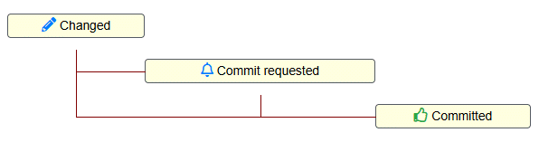\
*Workflow activity states and transitions*

---

### Transitions (TR)

A transition moves a document from one activity state to another:

```
State-A ──── Transition-AB ───► State-B
State-B ──── Transition-BC ───► State-C
```

Two preset transitions bound the workflow:

- **`TR_ENTER`** — triggered implicitly when basic state is set (enters the workflow).
- **`TR_LEAVE`** — triggered when the document is committed (leaves the workflow, content is published).

A simple workflow model:

```
TR_ENTER ──────────────────► AC_CHANGED
AC_CHANGED ─── Request Commit ─► AC_COMMIT_REQUESTED
AC_COMMIT_REQUESTED ─── Commit ─► TR_LEAVE → published
```

An extended workflow allows shortcuts (e.g. *Commit* directly from `AC_CHANGED`) and additional transitions such as *Reject* or *Rollback*:

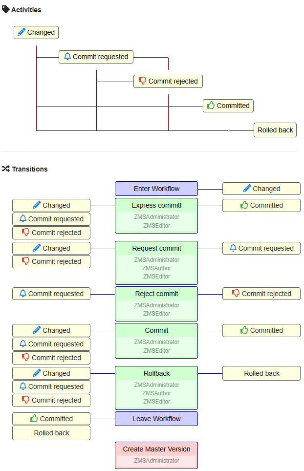\
*Extended workflow with reject and express-commit transitions*

Transitions can be restricted to specific user roles (e.g. only a *Manager* can execute *Commit*).

### Selective workflow

Workflow can be assigned to individual content nodes and applies recursively to all children. Assigning it to the root node activates it site-wide.

---

### Versioning

#### Two-slot versioning

Each block-level content object maintains two version slots:

| Slot | Description |
|---|---|
| `version_live_id` | ID of the currently published version |
| `version_work_id` | ID of the version currently being edited |

#### Container aggregate versioning

Because a ZMS page is composed of many block objects, the parent container tracks an aggregate version that increments with every child change. This creates a traceable history of which block was changed when:

```
document-e1:  0.0.1  {e2:0.0.1, e3:0.0.1, e4:0.0.1}
              0.0.2  {e2:0.0.1, e3:0.0.2, e4:0.0.1}
              0.0.3  {e2:0.0.1, e3:0.0.3, e4:0.0.1}
```

#### Version numbering

Versions follow `major.minor.patch`:

| Component | When incremented |
|---|---|
| `patch` | Each state transition within a workflow cycle |
| `minor` | Each save (without workflow) or on commit |
| `major` | Explicitly by user action ("Create Major Version") |

Creating a major version prunes all minor/patch history and reduces storage.

#### Versioning with workflow

When the workflow is active, each workflow transition creates a new *patch* version. A commit creates a new *minor* version and discards intermediate patches.

#### Versioning without workflow

Each save creates a new *minor* version. Users can manually review, compare, and restore previous versions from the **History** tab.

In both cases ZMS does not implicitly create a *major* version (like *patch* and *minor*) — it must be done explicitly by a user interaction ("Create Major Version"). Creating a major version prunes all minor and patch history and reduces data storage.

#### Implementation notes (DRAFT)

To implement versioning for a container that holds individually versioned sub-objects, a *version vector* tracks the composite state:

```python
class VersionedObject:
    def __init__(self, id):
        self.id = id
        self.version = 0
        self.sub_objects = {}
        self.change_log = []

    def add_sub_object(self, sub_object):
        self.sub_objects[sub_object.id] = sub_object
        self.update_version()

    def update_sub_object(self, sub_object_id, new_version):
        if sub_object_id in self.sub_objects:
            self.sub_objects[sub_object_id].version = new_version
            self.update_version()

    def update_version(self):
        self.version += 1
        self.change_log.append(self.get_version_vector())

    def get_version_vector(self):
        version_vector = {self.id: self.version}
        for sub_id, sub in self.sub_objects.items():
            version_vector[sub_id] = sub.version
        return version_vector

class SubObject:
    def __init__(self, id):
        self.id = id
        self.version = 0

# Usage
container = VersionedObject('container')
block1 = SubObject('block1')
block2 = SubObject('block2')
container.add_sub_object(block1)
container.add_sub_object(block2)
container.update_sub_object('block1', 1)
container.update_sub_object('block2', 2)
print(container.get_version_vector())
# → {'container': 4, 'block1': 1, 'block2': 2}
```

Key points of this approach:

- **Version Vector Structure** — includes the container version and all sub-object versions.
- **Composite Versioning** — the container's version reflects the combined state of all its sub-objects.
- **Change Log** — each `update_version` call appends a snapshot, providing a traceable history.
- **Incremental Updates** — the container increments whenever any sub-object changes.


---

## 11. Caching and Reverse-Proxy Deployment

In production ZMS sits behind a reverse proxy (NGINX, Apache). ZMS controls HTTP cache behaviour via response headers set by the helper function:

```python
# Products/zms/standard.py
set_response_headers_cache(context, request, cache_max_age=24*3600, cache_s_maxage=-1)
```

Key behaviours:

- **Preview / restricted content**: `Cache-Control: no-cache` is set automatically — proxies will not cache restricted pages.
- **Public content**: `Cache-Control: s-maxage=<proxy_ttl>, max-age=<browser_ttl>, public` is set.
- **Dynamic expiry**: when a page has a future `attr_active_start` or `attr_active_end` date, the TTL is automatically tightened to the nearest upcoming change. The `X-Accel-Expires` header carries this value to NGINX.
- **ETag cache-busting**: URLs with `?ETag=<token>` are cached indefinitely by the proxy; a changing token forces a new cache entry.

Typical production tuning:

```python
# In standard_html template (TAL)
<tal:block tal:define="
  standard modules/Products.zms/standard;
  dummy python:standard.set_response_headers_cache(this, request, cache_max_age=6*3600, cache_s_maxage=86400)">
</tal:block>
```

For instant cache invalidation, import the `manage_cachepurge` ZMS action and configure the external `cache_purge` method to call your NGINX cache-purge script. See [D. For Developers — Proxy Cache](d_for_developers.md#4-proxy-cache-and-http-caching) for the full proxy cache reference including ETag-based busting, parameter tuning, and purge script examples.

---

## 12. Security Hardening Checklist

- [ ] Run Zope as a dedicated non-root user.
- [ ] Restrict the Zope management interface (`/manage`) to localhost or a VPN.
- [ ] Use HTTPS with a valid certificate (Let's Encrypt or corporate CA) in front of the proxy.
- [ ] Rotate the Zope admin password after initial setup.
- [ ] Set `ZMS.debug = False` in production.
- [ ] Limit LDAP/Solr/Qdrant/Ollama network access to the Zope host.
- [ ] Keep ZMS, Zope, and all Python dependencies up to date.
- [ ] Never commit API keys or credentials to version control.
